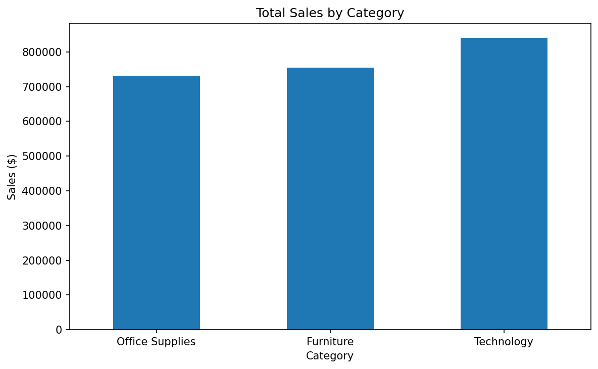
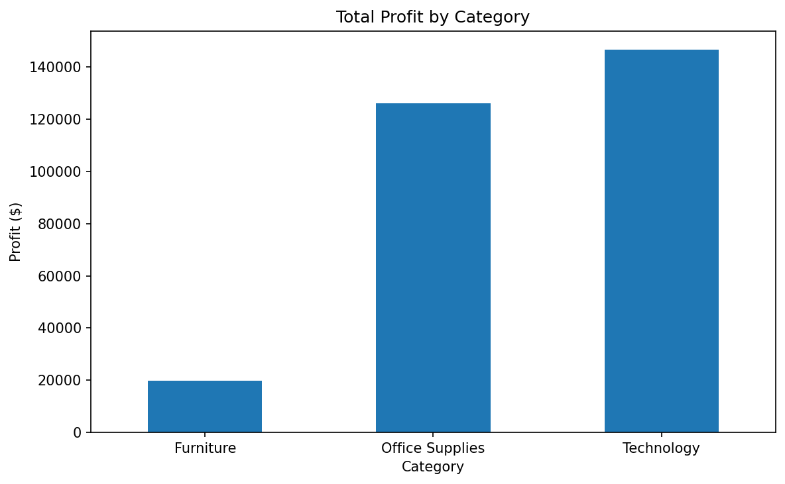
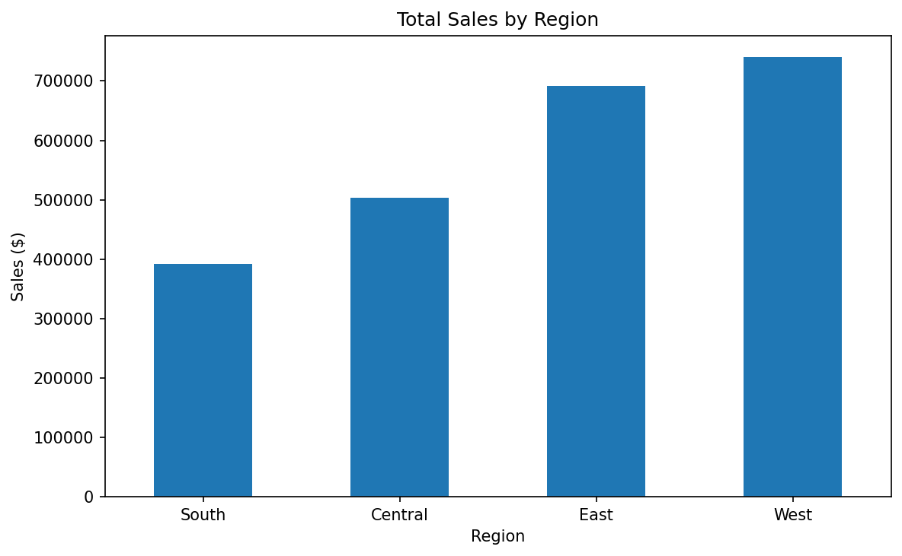
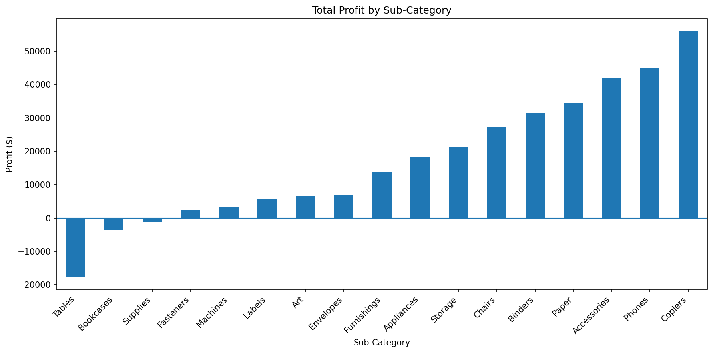
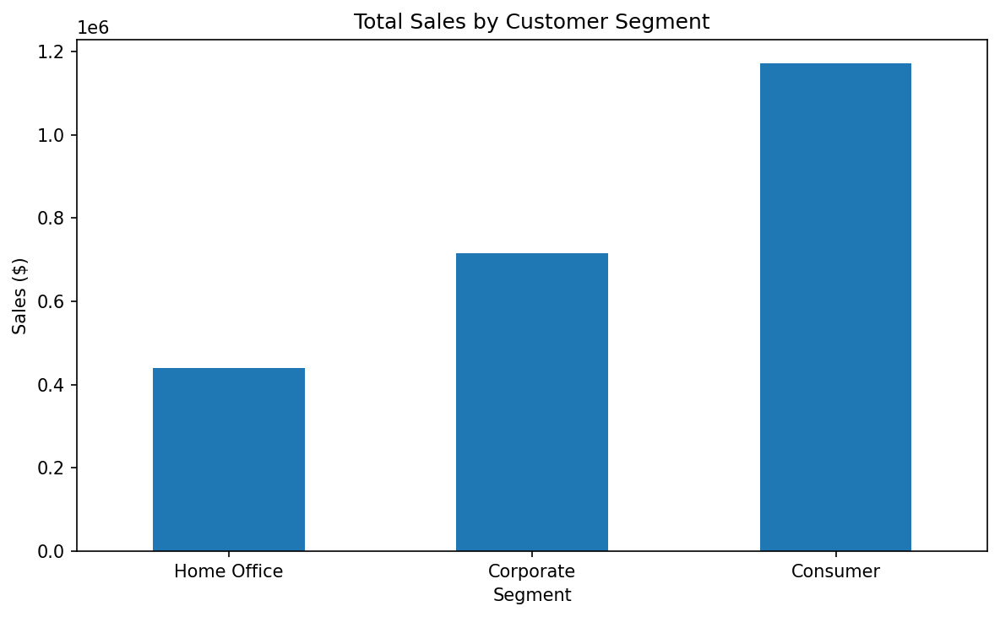
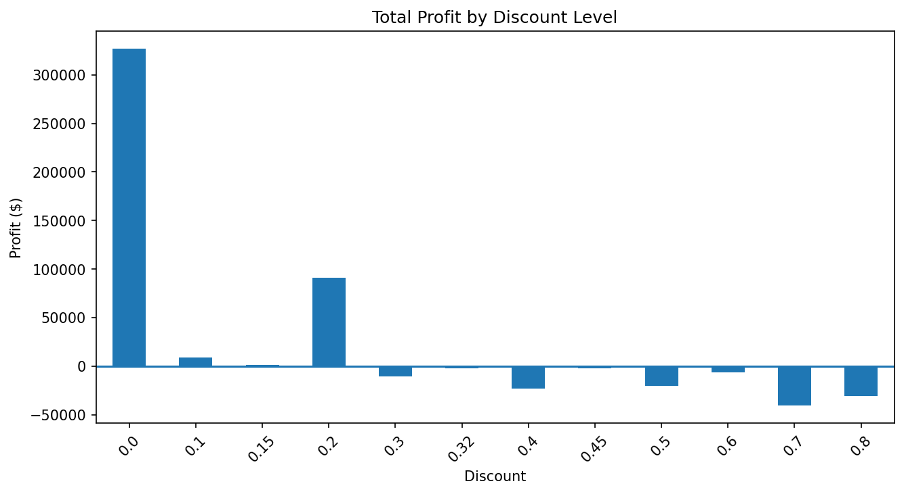
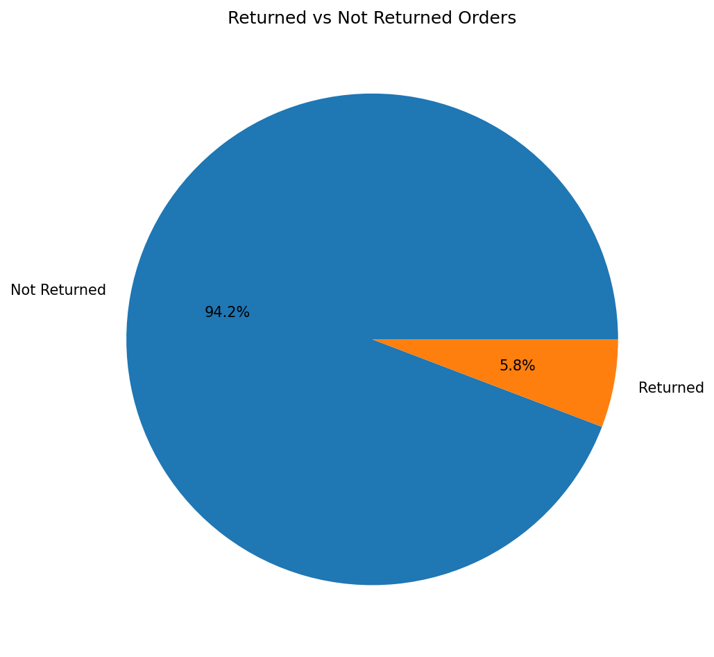

# Sample Superstore Sales & Profitability Analytics

## Project Overview
An end-to-end data analytics project analyzing sales, profitability, product performance, regional performance, customer segments, discounts, and returns using the Sample Superstore dataset.

## Tools Used
- **Excel:** Data cleaning and exploratory analysis
- **SQL (MySQL):** Business queries and data analysis
- **Python:** Data analysis and visualization using Pandas, NumPy, Matplotlib, and Seaborn
- **Power BI:** Interactive dashboards and business insights

## Key Business Insights
- Total sales: **$2,326,534.35**
- Total profit: **$292,296.81**
- Overall profit margin: **12.56%**
- Technology generated the highest sales and profit among the three categories.
- Tables, Bookcases, and Supplies were loss-making sub-categories.
- The West region generated the highest sales and profit.
- Higher discount levels were associated with losses at several discount levels.

## Project Structure
- `data/` — Source datasets
- `excel/` — Excel analysis
- `sql/` — SQL queries
- `python/` — Python notebook and analysis
- `power-bi/` — Power BI report

## Objective
To identify business performance trends and provide data-driven insights to support sales and profitability decisions.

## Python Data Visualizations

### Sales by Category

### Profit by Category

### Sales by Region

### Profit by Sub-Category

### Sales by Customer Segment

### Profit by Discount Level

### Returned vs Not Returned Orders

